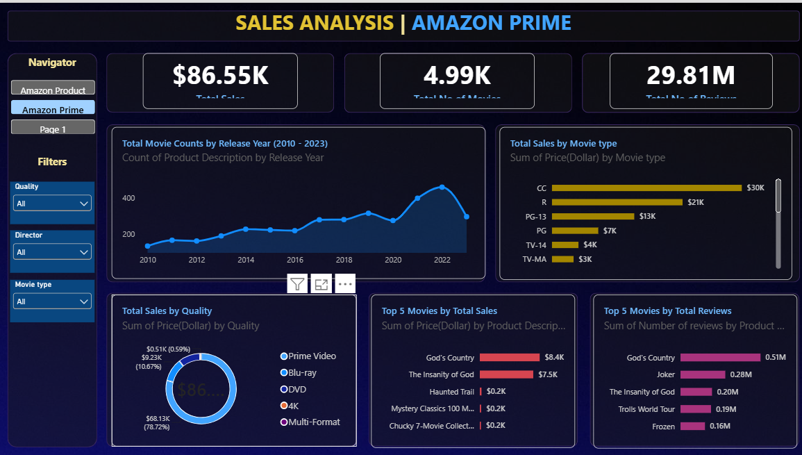
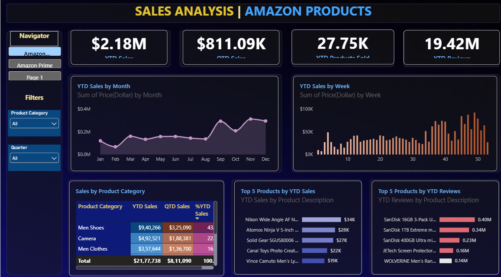

# Sales Analysis | Amazon Prime & Amazon Products

Interactive Power BI dashboards analyzing Amazon Prime movie sales and Amazon product sales.

## Dashboard 1: Amazon Prime

**Highlights**
- Total sales of $86.55K across 4.99K movies and 29.81M reviews
- Movie releases peaked around 2022
- Prime Video accounts for ~79% of sales by quality
- "God's Country" and "The Insanity of God" are the top-selling titles

## Dashboard 2: Amazon Products

**Highlights**
- YTD sales of $2.18M and QTD sales of $811.09K
- 27.75K products sold and 19.42M reviews YTD
- Sales climb in the second half of the year, with a peak around Q4
- Men Shoes, Camera, and Men Clothes are the top categories

## Tools Used
- Power BI (DAX, data modeling, slicers, page navigation)

## Features
- Page navigator and filters (Quality, Director, Movie type, Product Category, Quarter)
- KPI cards, trend charts, and Top 5 rankings
